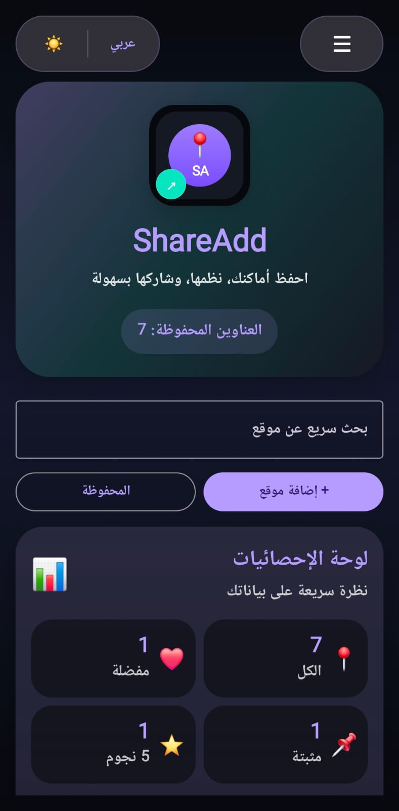
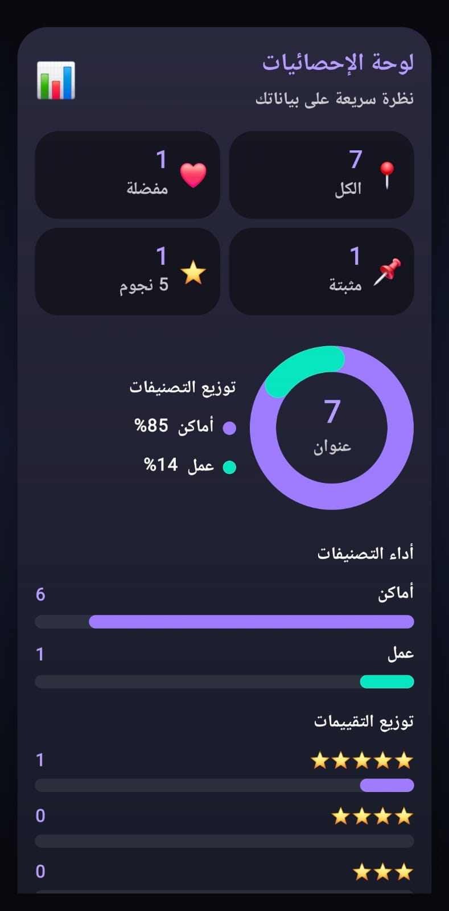
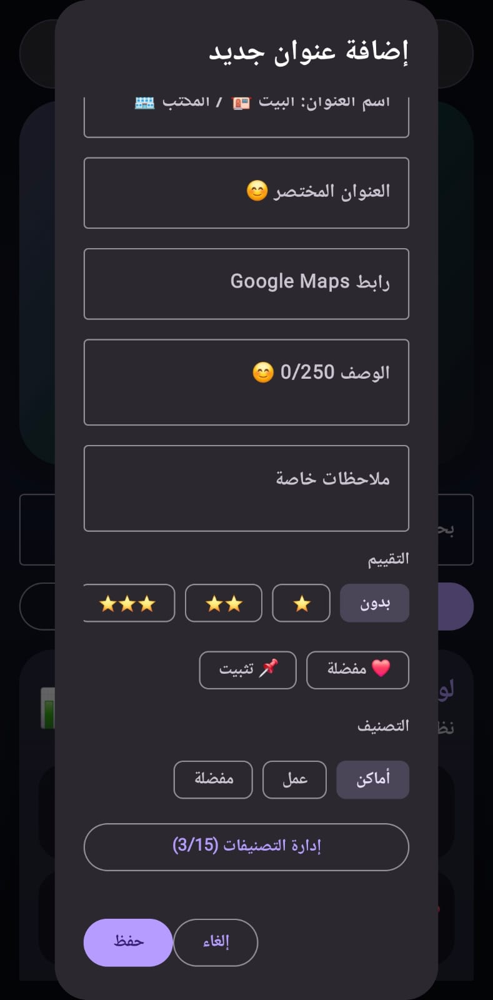
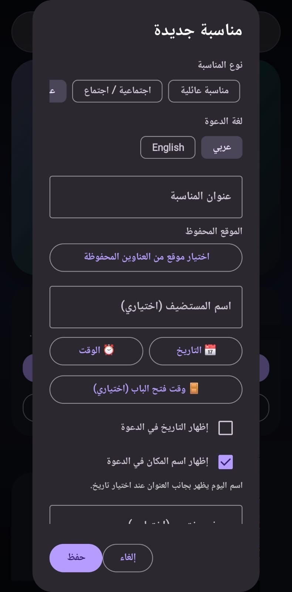
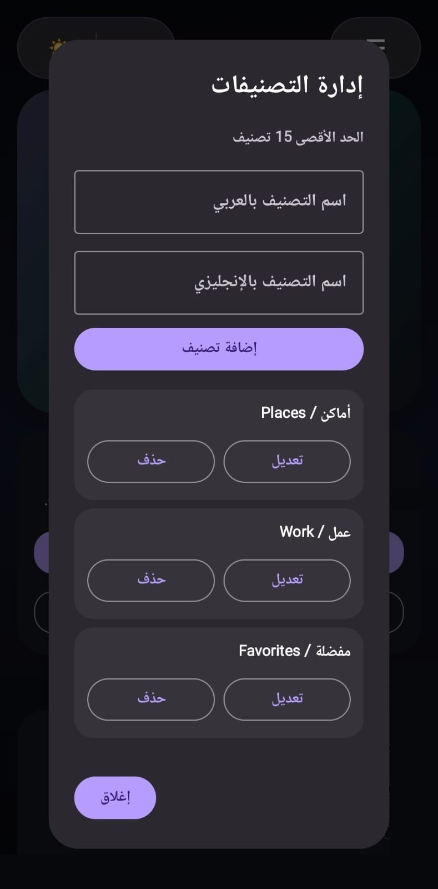
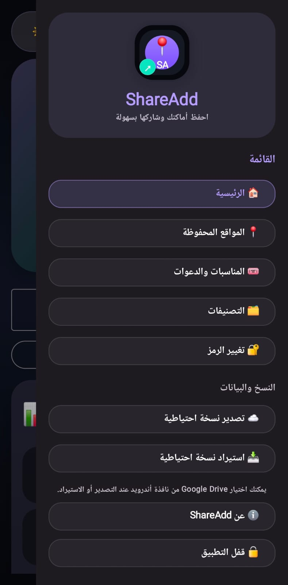

<h1 align="center">ShareAdd</h1>

<p align="center">
  <strong>Save. Organize. Share places beautifully.</strong><br>
  <span dir="rtl">احفظ أماكنك، نظمها، وشاركها بسهولة</span>
</p>

<p align="center">
  Android &nbsp;·&nbsp; Kotlin &nbsp;·&nbsp; Jetpack Compose &nbsp;·&nbsp; Arabic &amp; English
</p>

<p align="center">
  <a href="Download/ShareAdd-v1.2.1-release.apk">Download APK</a>
  &nbsp;·&nbsp;
  <a href="#features">Features</a>
  &nbsp;·&nbsp;
  <a href="#build-from-source">Build</a>
</p>

---

ShareAdd is a personal Android app for saving, organizing, and sharing places and addresses. Everything stays on your device: there is no account, no sign-in, and no cloud sync.

It was designed and built by one developer as an independent project, with a full Arabic (right-to-left) and English interface.

<p align="center">
  <a href="docs/screenshots/01-home-dashboard.jpg"></a>
  <a href="docs/screenshots/02-statistics.jpg"></a>
  <a href="docs/screenshots/03-add-address.jpg"></a>
</p>
<p align="center">
  <a href="docs/screenshots/04-event-invitation.jpg"></a>
  <a href="docs/screenshots/05-categories.jpg"></a>
  <a href="docs/screenshots/06-menu-backup.jpg"></a>
</p>
<p align="center"><sub>Home &nbsp;·&nbsp; Statistics &nbsp;·&nbsp; Add address &nbsp;·&nbsp; Event invitation &nbsp;·&nbsp; Categories &nbsp;·&nbsp; Backup menu<br>Arabic interface in dark mode. No personal saved places are shown.</sub></p>

## Features

**Places and addresses**
- Save places with a name, a short address, a map link, a description, and private notes
- Categories you define yourself, with Arabic and English names (up to 15)
- Star ratings, favorites, and pinned places
- Place photos stored privately inside the app
- Quick search and filtering
- Statistics: totals, category distribution, and rating distribution

**Events and invitations**
- Create event invitations linked to a saved place, in Arabic or English
- Optional date, time, door-opening time, and host name
- QR codes for places and for event invitations

**Sharing**
- Share a place or an invitation as clean, ready-to-send text

**Backup and restore**
- Export a backup file to your phone, Downloads folder, or Google Drive through Android's own file picker
- Import with a safety preview that shows what will change before anything is touched

**Everyday comfort**
- Arabic and English interface with right-to-left layout
- Light and dark themes
- PIN lock and biometric unlock

## Privacy

- No account, no sign-in, no cloud service, and no sync
- The app includes no analytics or advertising libraries; see the dependencies in [`app/build.gradle.kts`](app/build.gradle.kts)
- Links you save open in your own browser
- The PIN is stored as a hash on the device and is excluded from Android's automatic backups, as are temporary import files
- The PIN and biometric lock keep casual access out of the app. ShareAdd does not claim to encrypt your saved data

## Install

1. Download the APK: [ShareAdd-v1.2.1-release.apk](Download/ShareAdd-v1.2.1-release.apk) (version 1.2.1, about 8 MB).
2. Open it on your Android phone and allow installation from your browser or file manager when Android asks.
3. To confirm the file, compare its SHA-256 checksum with the one below.

```
SHA-256  3221c3757205cb4a3c1446a45c2ba330dc5b9dd14fe4f644d0affd05bba61493
```

The APK is signed with the developer's release key. Its certificate fingerprint is:

```
SHA-256  140726dc5f7070da680adfd1c34c35e16bafe883fb8c0b8c76220768a33559ee
```

Requires Android 8.0 (API 26) or newer. ShareAdd is distributed as an APK; it is not published on Google Play.

## Build from source

Requirements: Android Studio recent enough for Android Gradle Plugin 9.1, JDK 21, and the Android SDK 36.

```bash
./gradlew assembleDebug     # debug APK in app/build/outputs/apk/debug
./gradlew test              # unit tests
```

The unit tests cover the backup format, the import lifecycle, event and place sharing, link safety, and the invitation and QR code logic.

## Technology

Kotlin, Jetpack Compose, and Material 3. QR codes use ZXing. Biometric unlock uses AndroidX Biometric. Minimum Android version 8.0 (API 26).

## Repository layout

```
app/      the Android application
docs/     screenshots, and the development history notes
```

## Status

Version 1.2.1. A personal project, developed independently of my professional work.

## Author

Designed and developed by **Eng. Ali Hussain Al-Hanabi**, IT Manager and Head of Technology. [alhanabi.com](https://www.alhanabi.com)

## License

All rights reserved.
